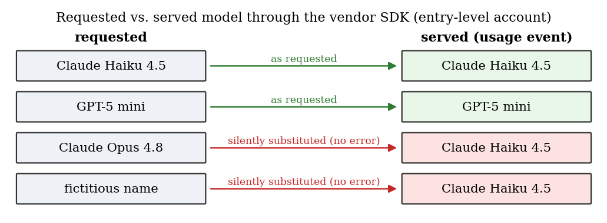
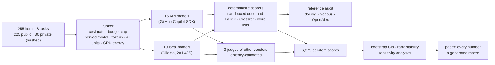
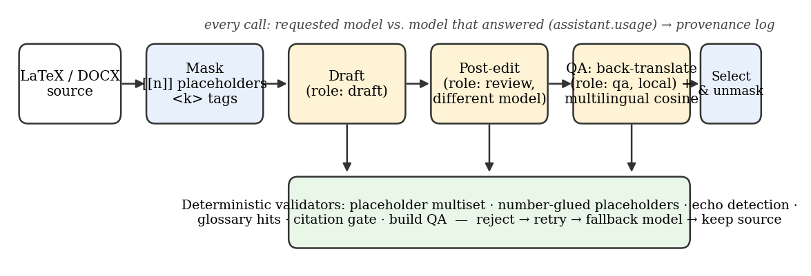
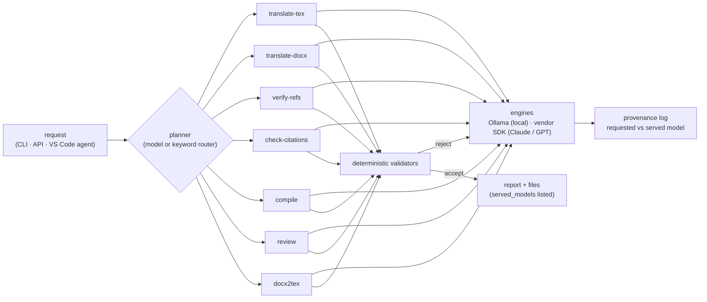
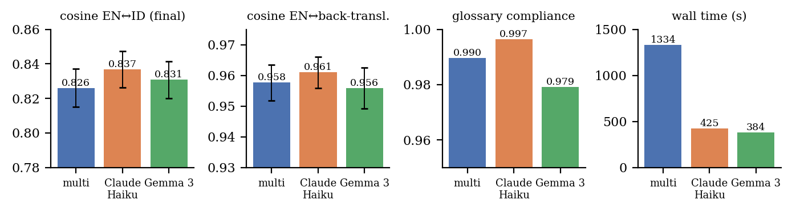
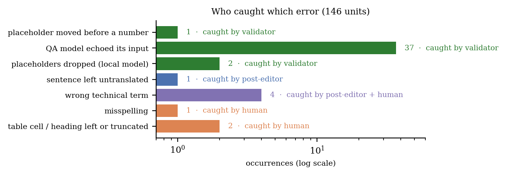
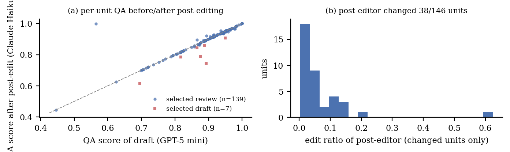
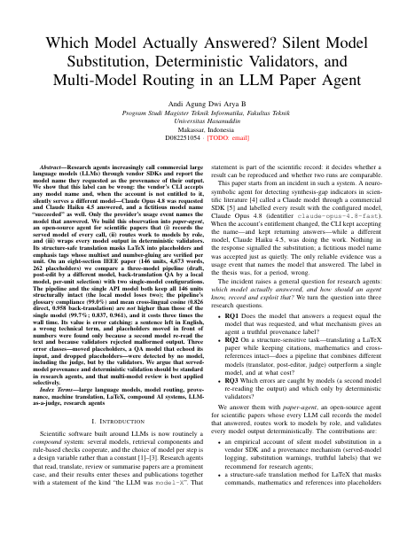
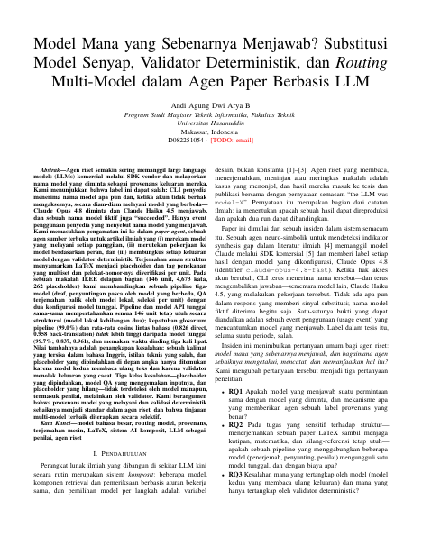

<div align="center">

# paper-agent

**Provenance-aware LLM tooling for scientific papers — and SkripsiBench, a benchmark of which model to trust with
Indonesian thesis work and research code.**

[](https://github.com/devnolife/paper-agent/actions/workflows/ci.yml)
[](pyproject.toml)
[](LICENSE)
<br>
[](paper/build/main.pdf)
[](paper/build/main_id.pdf)
[](paper_bench/build/main.pdf)
[](paper_bench/build/main_id.pdf)

[At a glance](#at-a-glance) · [For reviewers](#for-reviewers) · [SkripsiBench](#skripsibench) ·
[The tool](#the-tool-paper-agent) · [Install](#install) · [Papers](#papers) · [Citation](#citation)

</div>

---

## At a glance

This repository holds two studies and the code behind both. Every LLM call in either of them records **the model
that actually answered**, not the one that was requested.

| | **Which Model Actually Answered?** | **SkripsiBench** |
|---|---|---|
| **Question** | Can a research agent trust the model name it puts on its own output? | Which LLM should Indonesian students, supervisors and thesis tools use — and at what cost? |
| **Setup** | an 8-section IEEE paper (146 units) translated EN → ID by three model configurations | 255 items in 8 thesis tasks × 25 models (15 API, 10 local); 7,356 API calls, US$46.65, 6.1 GPU-hours |
| **Headline** | a vendor SDK silently answered with another model when the account was not entitled to the requested one; three error classes were caught by no model, only by deterministic validators | the three leading API models are not significantly different, yet cost differs 104× between models 0.04 apart; references separate the models; the best local model stays below the weakest API model |
| **Paper** | [English](paper/build/main.pdf) · [Indonesian](paper/build/main_id.pdf) — 7 pages | [English](paper_bench/build/main.pdf) · [Indonesian](paper_bench/build/main_id.pdf) — 8 pages |
| **Data** | [`experiments/translation/`](experiments/translation/) | [`experiments/bench/`](experiments/bench/) · items in [`bench/`](bench/README.md) |
| **Check it** | `python -m pytest -q` (deterministic, no network, no models) | `python experiments/bench/verify_release.py` (9 checks, ~2 s) |

<p align="center">
  
  &nbsp;
  
</p>

---

## For reviewers

> [!TIP]
> The headline numbers of both papers can be checked from this repository alone — no API key, no GPU, no private
> data. CI runs step 1 and the test suite on every push (Python 3.10 and 3.12).

### 1 · Verify the released results (about 2 seconds)

```bash
git clone https://github.com/devnolife/paper-agent.git && cd paper-agent
pip install -e .
python experiments/bench/verify_release.py
```

It recomputes, from the 6,375 released per-item scores, the task and overall scores, the ranking, the
task-stratified rank bootstrap with the paired difference to the leader, the three sensitivity analyses, the served
models of the main run, the SHA-256 of the public items, and the 24 key numbers printed in the paper:

```text
ok    task and overall scores (25 models x 8 tasks, 6375 item scores)                 max |diff| 0.000067 vs summary.json
ok    overall ranking                                                                 same order as summary.json
ok    rank bootstrap: P(rank 1), rank CIs, paired difference to the leader [95 % CI]  max |diff| P(top1) 0.0000, difference/CI 0.00000; rank CIs identical
ok    ranking with prose scored by automatic checks only / judges only                Spearman rho 0.994 / 0.996
ok    ranking without the private extraction task                                     Spearman rho 0.999, largest rank shift 1
ok    ranking with the works found by the reference audit credited                    40 references, Spearman rho 0.999, largest rank shift 1
ok    served model = requested model (main run, API models)                           3825 calls of 15 models
ok    public items match bench/MANIFEST.json (SHA-256)                                225 public items identical, 30 private items listed as hashes only
ok    numbers printed in the paper (generated/numbers.tex)                            24 macros recomputed

9/9 checks agree
```

### 2 · Rebuild the SkripsiBench paper from the data (about a minute; needs TeX Live)

```bash
pip install matplotlib
python experiments/bench/make_figures.py     # figures from summary.json, analysis.json, refs_audit.json
python paper_bench/make_tables.py            # tables and every number in the text -> paper_bench/generated/
paper-agent compile paper_bench/main.tex     # 8 pages, 0 undefined references or citations
paper-agent check-citations --tex paper_bench/main.tex --bib paper_bench/references.bib \
                            --report paper_bench/references_report.md
```

No number in the text is typed by hand: each is a macro in
[`generated/numbers.tex`](paper_bench/generated/numbers.tex), written by
[`make_tables.py`](paper_bench/make_tables.py).

### 3 · Where each claim comes from

| Claim (SkripsiBench) | Value | Evidence |
|---|---|---|
| The three leaders are not significantly different | paired difference to the leader 0.006 [−0.014, 0.027] and 0.010 [−0.010, 0.028] | [`analysis.json`](experiments/bench/analysis.json) → `rank_bootstrap.*.diff_ci` |
| Price differs about 100× among comparable models | US$3.12 vs US$0.030 per 100 items for 0.941 vs 0.901 | [`summary.json`](experiments/bench/summary.json) → `models.*.cost.usd_per_100` |
| References separate the models | 0–31 % of an API model's references are found in no database (local models: 61–85 %) | [`refs_audit.json`](experiments/bench/refs_audit.json) → `models.*.no_match_rate` |
| The ranking does not hinge on the judges, the private task or Crossref coverage | Spearman ρ 0.994 (no judges), 0.999 (no private task), 0.999 (audit credited) | `analysis.json` → `judge_sensitivity`, `public_only`, `verification_sensitivity` |
| The judges agree | Krippendorff's α = 0.86 (interval), on 480 answers rated by all three | `analysis.json` → `judges` |
| No silent substitution in this study | served = requested for every call of the main run (3,825) | `summary.json` → `models.*.cost.served` |
| Every citation in the paper is verified | 23 in ≥ 2 independent sources, 5 manual (software, web, manuscript) | [`references_report.md`](paper_bench/references_report.md) |

| Claim (Which Model Actually Answered?) | Evidence |
|---|---|
| The SDK substitutes a model silently; only the `assistant.usage` event names the one that answered | [paper](paper/build/main.pdf), Sections III–V; served-model logging in [`engines.py`](paper_agent/engines.py) |
| The three translation configurations are within one standard error on the automatic metrics | [`experiments/translation/summary.json`](experiments/translation/summary.json), per-unit files beside it |
| Three error classes were caught only by validators | [`latex_mask.py`](paper_agent/latex_mask.py) (`integrity_ok`), [`translate_tex.py`](paper_agent/translate_tex.py); tests in [`tests/test_core.py`](tests/test_core.py) |

### 4 · What is released, and what is not

| Released | Not released, and why |
|---|---|
| 225 public items, word lists, item generators, model roster ([`bench/`](bench/README.md)) | the 30 extraction items: masked excerpts of real theses (privacy); their SHA-256 are in [`MANIFEST.json`](bench/MANIFEST.json) |
| runner, scorers, sandbox, judges, statistics ([`paper_agent/bench/`](paper_agent/bench/)) | raw answers and judge ratings: they include the answers on the private excerpts |
| per-item scores of all 25 models, summary, analyses, reference audit (aggregates only) | API credentials: bring your own Copilot token; local models run on any Ollama server |

### 5 · Re-running the benchmark

`paper-agent bench plan --tiers economy standard local` counts the calls and estimates their cost without calling any
model; `run` is resumable and refuses the premium tier and high reasoning effort without `--approve-high-cost`, and
`--budget-usd` stops new calls when a spending cap is reached. This study cost US$46.65 in API calls (answers 21.52,
judges 24.50, cost probes 0.63) and 6.1 GPU-hours. Environment: GitHub Copilot SDK 1.0.9 (Copilot CLI 1.0.73),
Ollama 0.22 on two NVIDIA L40S; API models as enabled for the author's account on 14 October 2026; fixed bootstrap
seeds. Hosted models change without notice, so a re-run measures the models of its own date.

### 6 · Threats to validity

Stated in both papers and summarised under [Limitations](#limitations): one run per model and item; no human
validation yet of item keys, judges and extraction silver labels (blind sheets for two raters are generated by
`paper-agent bench human-sheet`); structure references from the theses of one university; local energy measured on a
shared server; the premium tier not included.

---

## SkripsiBench

Vendor leaderboards rank models on English knowledge and reasoning; none of them says which model to use for a
*skripsi*, the Indonesian undergraduate thesis. **SkripsiBench** is 255 items in eight tasks taken from that
workflow — chapter outlines per study programme, methodology questions, methods extraction from real theses, grounded
literature reviews, reference lists, formal Indonesian, data-analysis code and LaTeX — scored deterministically
wherever possible, with LLM judges of other vendors for prose, and with the served model, tokens, cost and GPU energy
recorded for every call. Task definitions, scoring rules and how to run it: [`bench/README.md`](bench/README.md).



**Why the scores can be trusted.** Six of the eight tasks are scored without an LLM, and the two prose tasks are
half deterministic. Model-written programs and LaTeX run in a sandbox (Linux user, mount, network and PID namespaces,
no network, capabilities dropped, cgroup limits). References are looked up in Crossref with paper-agent's matching
rule, and every miss is audited again in doi.org, Scopus and OpenAlex. A judge never rates models of its own vendor,
and each judge's leniency is removed before averaging. Failed calls score 0 instead of disappearing.

### Leaderboard

25 models ran on 14–15 October 2026: 15 API models of the GitHub Copilot SDK (grouped by name into an economy and a
standard tier, low reasoning effort where a model accepts one) and 10 local open-weight models on a shared Ollama
server with two L40S GPUs. Cost per 100 items: API models in the vendor's AI units at US$0.01, local models as GPU
time at an on-demand L40S price (US$1.09/h).

| # | Model | Tier | Overall [95 % CI] | Academic | Code | US$ / 100 items | Median s / call |
|---:|---|---|---|---:|---:|---:|---:|
| 1 | **kimi-k3** | economy | **0.941** [0.92, 0.96] | 0.930 | 0.975 | 3.119 | 34.5 |
| 2 | **gpt-5.4** | standard | **0.935** [0.92, 0.95] | 0.913 | 1.000 | 0.864 | 7.9 |
| 3 | **gpt-6.1-sol** | standard | **0.931** [0.92, 0.95] | 0.908 | 1.000 | 0.461 | 8.3 |
| 4 | claude-sonnet-5.5 | standard | 0.913 [0.89, 0.93] | 0.890 | 0.983 | 0.783 | 4.8 |
| 5 | gpt-5.6-terra | standard | 0.913 [0.89, 0.94] | 0.898 | 0.958 | 0.585 | 5.9 |
| 6 | gemini-3.7-flash | economy | 0.911 [0.90, 0.92] | 0.882 | 1.000 | 0.141 | 15.4 |
| 7 | gemini-4-argon | standard | 0.901 [0.88, 0.92] | 0.868 | 1.000 | 0.396 | 5.8 |
| 8 | gpt-6-luna | standard | 0.901 [0.87, 0.93] | 0.901 | 0.900 | 0.030 | 7.0 |
| 9 | claude-haiku-5.5 | economy | 0.895 [0.87, 0.92] | 0.868 | 0.975 | 0.056 | 6.8 |
| 10 | gemini-3.8-flash | economy | 0.893 [0.87, 0.91] | 0.857 | 1.000 | 0.145 | 18.6 |
| 11 | gpt-5.4-mini | economy | 0.883 [0.86, 0.91] | 0.868 | 0.931 | 0.252 | 4.8 |
| 12 | claude-sonnet-5 | standard | 0.876 [0.85, 0.90] | 0.834 | 1.000 | 0.711 | 5.8 |
| 13 | mai-code-1.1-flash | economy | 0.837 [0.81, 0.86] | 0.808 | 0.922 | 0.157 | 7.9 |
| 14 | gpt-5-mini | economy | 0.816 [0.78, 0.85] | 0.790 | 0.892 | 0.136 | 7.7 |
| 15 | claude-haiku-4.5 | economy | 0.777 [0.74, 0.81] | 0.762 | 0.823 | 0.598 | 10.6 |
| 16 | Qwen3.6 36B | local | 0.745 [0.71, 0.77] | 0.719 | 0.825 | 0.655 | 57.7 |
| 17 | gpt-oss 20B | local | 0.723 [0.70, 0.74] | 0.661 | 0.908 | 0.087 | 4.1 |
| 18 | Gemma 3 27B | local | 0.691 [0.66, 0.72] | 0.680 | 0.727 | 0.170 | 9.6 |
| 19 | Gemma 4 8B | local | 0.668 [0.64, 0.70] | 0.671 | 0.660 | 0.183 | 13.6 |
| 20 | Phi-4 reasoning plus 14.7B | local | 0.639 [0.60, 0.67] | 0.586 | 0.801 | 0.693 | 8.7 |
| 21 | Qwen2.5-Coder 32B | local | 0.621 [0.59, 0.65] | 0.604 | 0.674 | 0.259 | 20.2 |
| 22 | Qwen3-Coder 30B-A3B | local | 0.618 [0.58, 0.65] | 0.597 | 0.681 | 0.236 | 3.2 |
| 23 | Qwen2.5 7B Instruct | local | 0.518 [0.48, 0.55] | 0.523 | 0.503 | 0.083 | 4.7 |
| 24 | Gemma2 9B CPT SahabatAI | local | 0.517 [0.48, 0.55] | 0.571 | 0.357 | 0.299 | 5.9 |
| 25 | Llama 3.2 3B | local | 0.368 [0.34, 0.40] | 0.408 | 0.248 | 0.067 | 3.4 |

Per-task scores: [`leaderboard.md`](experiments/bench/leaderboard.md) · per-item scores:
[`per_item.csv`](experiments/bench/per_item.csv) · analyses: [`analysis.json`](experiments/bench/analysis.json) ·
reference audit: [`refs_audit.json`](experiments/bench/refs_audit.json)

<details>
<summary><b>Per-task scores at a glance</b> (heatmap)</summary>
<p align="center"></p>
</details>

### Findings

<p align="center">
  
  &nbsp;
  
</p>

* **The three leaders are not significantly different.** The paired difference to kimi-k3 is 0.006 [−0.014, 0.027]
  for gpt-5.4 and 0.010 [−0.010, 0.028] for gpt-6.1-sol (task-stratified bootstrap). That is not equivalence, and two
  tasks (methodology questions, formal Indonesian) are near ceiling for every API model.
* **Price is what differs.** Per 100 items kimi-k3 costs US$3.12 (it reasons at length: median 34.5 s per call),
  gpt-6.1-sol US$0.46, and gpt-6-luna reaches 0.901 for US$0.030 — 104 times less for 0.04 less. Tier names are a
  poor guide: the most expensive model per item was grouped with the economy models.
* **References separate the models.** 0–40 % of the references an API model listed are not found in Crossref. The
  second-source audit ([`audit_refs.py`](experiments/bench/audit_refs.py)) finds 17 % of those misses with matching
  metadata elsewhere; 0–31 % of an API model's references are found in no database, against 61–85 % for local
  models. Verify every reference a model produces.
* **Local models trail on every task, on average.** The best, Qwen3.6 36B (0.745), stays below the weakest API model
  (claude-haiku-4.5, 0.777), and at rental prices local models were not cheaper per item; they come closest on formal
  Indonesian. The Indonesian-tuned SahabatAI 9B did not write formal Indonesian better than the general Gemma 4 8B.
* **Provenance and judges.** The SDK reported the requested model as the serving model for all 7,356 calls (no
  substitution, unlike the incident of the first paper). The three judges agree (Krippendorff's α = 0.86), and
  scoring the prose by the deterministic checks alone barely changes the ranking (Spearman ρ = 0.994).

> [!NOTE]
> Not in this version: the nine premium-tier models (estimated at about US$50 for all items; the runner gates them
> behind an explicit approval and a budget cap), a high-effort check of the leaders, repeated runs, and the
> comparison of the judges with two human raters.

---

## The tool: paper-agent

**An agent for scientific papers whose every LLM call records the model that actually answered.** Translate a LaTeX
or Word paper without breaking a single `\cite`, verify every reference against bibliographic databases, gate
citations, build and QA the PDF, get two independent model reviews, convert a DOCX manuscript to IEEE LaTeX — and
know, for every step, *which model did the work*.

<p align="center">
  
</p>

### Why it exists: the model you asked for is not always the model you get

While building a research agent on a commercial model SDK we found that the vendor's CLI accepts **any** model
name. When the account is not entitled to that model it silently answers with another one. The response object is
identical in both cases; only the SDK's `assistant.usage` event names the model that generated the tokens.

<p align="center">
  
</p>

A pipeline that labels its output with the *requested* model therefore misreports its own provenance — for a while a
thesis claimed Claude Opus 4.8 for work done by Claude Haiku 4.5. `paper-agent` was built around three answers:

1. **Provenance over labels** — every call stores the served model; substitutions are logged once per pair; all reports list `served_models`.
2. **Roles, not model names** — `draft`, `review`, `qa`, `fallback`, `critic`, `critic2`, `planner`; the post-editor is never the drafting model and the two critics are never the same model.
3. **Deterministic validators under every model** — placeholder multisets, number-glued placeholders, echo detection, glossary hits, citation gate, build QA. They reject malformed model output before it can reach the document.

### Commands

| Command | What it does |
|---|---|
| `paper-agent translate-tex` | EN → target language for LaTeX sections. Commands, math, `\cite`/`\ref`, identifiers → placeholders `⟦n⟧`; `\emph`/`\textbf` → tags `<k>…</k>`; multiset + number-gluing verified per unit. Pipeline `multi` = draft model → post-editor (different model) → back-translation QA (local model) + cross-lingual cosine → per-unit selection. |
| `paper-agent translate-docx` | Translate a Word manuscript in place; bold/italic/superscript runs preserved through tags; references, formulas and identifiers skipped. |
| `paper-agent verify-refs` | Verify a reference seed (YAML) against Crossref, OpenAlex, Semantic Scholar, Scopus and arXiv — ≥ 2 independent sources = `VERIFIED`; wrong seed DOIs are reported and replaced; BibTeX fetched from doi.org and validated. Nothing is cited from memory. |
| `paper-agent check-citations` | Gate: every `\cite` key exists in the `.bib` **and** is `VERIFIED`/`MANUAL` in the report. Exit 1 otherwise. |
| `paper-agent compile` | `latexmk` build + QA: pages, undefined refs/cites, overfull boxes, leftover `[TODO: …]` markers. |
| `paper-agent review` | Two independent critics (different models) review the paper against a fixed rubric; findings merged, issues raised by both marked `AGREED`, each finding tagged with the model that produced it. |
| `paper-agent docx2tex` | DOCX → compilable IEEEtran project: headings, runs, tables, embedded images, numeric citations → `\cite{refN}`, reference list → `.bib` + a verification seed to curate. |
| `paper-agent run "<request>"` | Natural-language task → plan of whitelisted tool calls (planner model, keyword router as fallback) → execution → per-step report with served models. Paths are confined to the working directory. |
| `paper-agent serve` | The same operations as an HTTP API (FastAPI): `/v1/run`, `/v1/translate/tex`, `/v1/compile`, `/v1/citations/check`, `/v1/review`, `/v1/status`. |
| `paper-agent status` | Which engines and models are reachable (Ollama tags, API-model authentication and token source). |
| `paper-agent bench` | SkripsiBench: `plan` (cost estimate), `run` (resumable, cost-gated, budget cap), `silver`, `judge`, `score`, `human-sheet`/`human-ingest`, `report`, `manifest`, `check` — see [`bench/README.md`](bench/README.md). |



### Results: structure-safe translation (first paper)

The companion paper translated an eight-section IEEE paper (146 units, 4 673 words, 262 placeholders) with three
configurations on the *same* units and glossary. Full per-unit metrics are in [`experiments/translation/`](experiments/translation/);
[`experiments/make_figures.py`](experiments/make_figures.py) regenerates every figure below.

<p align="center">
  
</p>

| Metric | **multi** (GPT-5 mini → Claude Haiku 4.5 → Gemma 3 QA) | **single** Claude Haiku 4.5 | **single** Gemma 3 27B (local) |
|---|---|---|---|
| Structurally intact units | 146/146 | 146/146 | 144/146 |
| Glossary compliance | 99.0 % | **99.7 %** | 97.9 % |
| Cosine EN↔ID (final text) | 0.826 ± 0.011 | **0.837 ± 0.011** | 0.831 ± 0.011 |
| Cosine EN↔back-translation | 0.958 | **0.961** | 0.956 |
| Wall time | 1 334 s | 425 s | **384 s** |
| API calls (served model) | 16 GPT-5 mini + 16 Claude Haiku 4.5 | 17 Claude Haiku 4.5 | 0 |

**The headline is not "more models = better".** On the automatic metrics the three configurations are within one
standard error of each other and the single API model is the cheapest way to get there. The multi-model pipeline
earned its cost elsewhere: its post-editor fixed semantic errors that no metric registers — a whole sentence left in
English, *inferred* rendered as "derived", *show* rendered as "proven" — and three error classes were caught by **no
model at all**, only by the validators:

<p align="center">
  
</p>

* **Placeholder moved before a number** — the post-editor "tidied" `58⟦3⟧` (58\%) into `⟦3⟧58`; the multiset check passed, so a number-gluing rule was added.
* **QA model echoed its input** — on 37 short units the local back-translator returned the Indonesian text unchanged, collapsing the QA score; a string comparison turns these into failed calls that are retried.
* **Placeholders dropped** — the local model as sole translator lost placeholders in two paragraphs; without a fallback model they stay in English and are reported.

<p align="center">
  
</p>

The post-editor changed 38 of 146 units; the per-unit QA scores before and after post-editing lie on the diagonal
(left) — the corrections are real but invisible to the metric — and most edits are small (right).

### How the structure-safe translation works

```text
source   Fig.~\ref{fig:arch} shows the four phases~\cite{hevner2004}; only 58\% recurred in \emph{two} runs.
masked   Fig.⟦0⟧ shows the four phases⟦1⟧; only 58⟦2⟧ recurred in <1>two</1> runs.
model    Gambar⟦0⟧ menunjukkan empat fase⟦1⟧; hanya 58⟦2⟧ yang berulang pada <1>dua</1> run.
checks   placeholders {0,1,2} ✓   tags {1} ✓   "58⟦2⟧" still glued ✓   back-translation ≠ input ✓
output   Gambar~\ref{fig:arch} menunjukkan empat fase~\cite{hevner2004}; hanya 58\% yang berulang pada \emph{dua} run.
```

Units are paragraphs, `\section`/`\caption` arguments, table cells and `\item` bodies; everything that is pure
structure (`\begin`, `\label`, `\includegraphics`, rules, comments) is copied verbatim. A deterministic pass turns the
word before `~\ref` ("Fig.", "Table", "Section") into the target language. Rejected output is retried, then sent to
the fallback model, and finally the source text is kept and reported — never silently dropped.

---

## Install

```bash
git clone https://github.com/devnolife/paper-agent.git && cd paper-agent
pip install -e ".[copilot,qa,api,dev]"
#   copilot → vendor SDK that serves the Claude / GPT models     qa → sentence-transformers for cross-lingual QA
#   api     → FastAPI server                                     dev → pytest + pyflakes
```

System tools: **TeX Live** (`texlive-latex-extra texlive-publishers latexmk`; `texlive-lang-other` for `babel[bahasa]`),
**poppler-utils** (`pdftotext`, `pdftoppm`), and optionally an **Ollama** server with a local model (default `gemma3:27b`).

Configuration is by environment; a `.env` in the working directory (or any parent) is loaded:

```ini
COPILOT_GITHUB_TOKEN=github_pat_…        # token for the Claude/GPT engine (fine-grained PAT, permission "Copilot Requests"), or log in with the vendor CLI
OLLAMA_URL=http://127.0.0.1:11434
CROSSREF_EMAIL=you@example.org           # polite-pool contact for Crossref / OpenAlex
BROWSER_AGENT_URL=http://127.0.0.1:8780  # optional: Scopus / Semantic Scholar through a browser-agent
BROWSER_AGENT_API_KEY=…
PAPER_AGENT_ROLES={"draft":["copilot","gpt-5-mini"],"review":["copilot","claude-haiku-4.5"],"qa":["ollama","gemma3:27b"]}
```

Default roles (an entry-level subscription can run them): `draft` GPT-5 mini · `review` Claude Haiku 4.5 ·
`qa`/`fallback`/`critic2` Gemma 3 27B (local) · `critic` Claude Haiku 4.5 · `planner` GPT-5 mini.

---

## Quick start

```bash
paper-agent status                                   # engines, models, authentication

# translate the LaTeX sections, compile the Indonesian main file, gate its citations
paper-agent translate-tex --src paper/sections --out paper/sections_id --glossary paper/glossary_id.yaml
paper-agent compile paper/main_id.tex
paper-agent check-citations --tex paper/main_id.tex --bib paper/references.bib --report paper/references_report.md

# references: curate the seed once, verify, then never cite anything that is not VERIFIED/MANUAL
paper-agent verify-refs --seed paper/references_seed.yaml --bib paper/references.bib --report paper/references_report.md

# two independent critics
paper-agent review paper/main.tex -o paper/review.md

# Word manuscript → IEEE LaTeX project
paper-agent docx2tex manuscript.docx -o converted

# or just say what you want
paper-agent run "terjemahkan paper ke bahasa Indonesia lalu kompilasi" --workdir .
```

What a translation report looks like (`paper/translation/multi_report.md`):

```
# Translation report — pipeline `multi`
- units: 131 (4203 words); untranslated (kept source language): 0
- roles: draft=copilot:gpt-5-mini, review=copilot:claude-haiku-4.5, qa=ollama:gemma3:27b, …
- served models (copilot may substitute): {'copilot:gpt-5-mini': 15, 'copilot:claude-haiku-4.5': 15, 'ollama:gemma3:27b': 78}
- glossary compliance: 336/352
## stage `draft`    s_per_unit: 7.1  cosine_direct: 0.863  cosine_back: 0.956
## stage `review`   s_per_unit: 6.4  cosine_direct: 0.881  cosine_back: 0.959  edit_ratio: 0.017  changed_units: 23
- selected: {'draft': 3, 'review': 128}
```

Smoke tests before a long run: `--dry-run` prints masking statistics and checks that mask → unmask reproduces the
source byte for byte; `--limit 5` translates the first five units only; `--pipeline single:ollama:gemma3:27b` runs
one model. Runs are cached per unit (`paper/translation/<pipeline>.json`) and resume after interruption or edits —
only changed units are sent to the models again.

---

## Use it inside your own paper or thesis repository

```make
paper:            ; paper-agent compile paper/main.tex
paper-id:         ; paper-agent compile paper/main_id.tex
paper-translate:  ; paper-agent translate-tex --src paper/sections --out paper/sections_id --glossary paper/glossary_id.yaml
paper-check:      ; paper-agent check-citations --tex paper/main.tex --bib paper/references.bib --report paper/references_report.md
paper-review:     ; paper-agent review paper/main.tex -o paper/review.md
```

**VS Code:** copy [`integrations/vscode/paper-agent.agent.md`](integrations/vscode/paper-agent.agent.md) to
`.github/agents/` in your repository. "Paper Agent" then appears in the chat agent picker and drives the CLI from
natural language ("verify the references", "terjemahkan paper lalu kompilasi"), always quoting the served models from the
tool's reports rather than configuration values.

**HTTP:** `paper-agent serve --port 8790`, then
`curl -X POST localhost:8790/v1/run -H 'content-type: application/json' -d '{"request": "translate the paper to Indonesian"}'`.

---

## Papers

### SkripsiBench: Which Language Model for Indonesian Academic Writing and Research Code? Quality, Cost and Provenance of Local and API Models

[`paper_bench/`](paper_bench/) — IEEE conference format, 8 pages, 28 references (23 verified in ≥ 2 bibliographic
sources, 5 software/web/manuscript references marked `MANUAL`).

<p align="center">
  <a href="paper_bench/build/main.pdf"></a>
  &nbsp;&nbsp;
  <a href="paper_bench/build/main_id.pdf"></a>
</p>

Every number in the text is a macro generated from the run data, so a new run updates the paper by regenerating and
recompiling. The Indonesian version was translated by `paper-agent translate-tex` from the same sections (111 units,
none left untranslated, glossary compliance 94 %, cosine 0.94 to the back-translation; served models GPT-5 mini,
Claude Haiku 4.5, Gemma 3 27B) and then post-edited in 89 places that [`postedit_id.py`](paper_bench/postedit_id.py)
lists and re-applies. Translating it exposed two masking bugs, now fixed and tested: a `\caption{…}` spanning lines
lost its last character and gained a stray `}`, and a `\paragraph{Title}` followed by text on the same line kept
its title untranslated. [`review.md`](paper_bench/review.md) is the output of `paper-agent review` on the English
paper (critics: gpt-6.1-sol and claude-sonnet-5.5 at low effort): four overclaims it found were softened before
release, and its main points — no human validation yet, single runs, the premium tier missing, confounded local cost
— are the limitations the paper states.

### Which Model Actually Answered? Silent Model Substitution, Deterministic Validators, and Multi-Model Routing in an LLM Paper Agent

[`paper/`](paper/) contains **"Which Model Actually Answered? Silent Model Substitution, Deterministic Validators, and
Multi-Model Routing in an LLM Paper Agent"** (IEEE conference format, 7 pages, 27 references — 23 verified in ≥ 2
bibliographic sources, 4 web/manuscript references marked `MANUAL`).

<p align="center">
  <a href="paper/build/main.pdf"></a>
  &nbsp;&nbsp;
  <a href="paper/build/main_id.pdf"></a>
</p>

The Indonesian version was produced by `paper-agent translate-tex` itself (131 units, 131/131 structurally intact,
glossary compliance 95.7 %, cosine 0.88 direct / 0.96 back-translation; served models GPT-5 mini, Claude Haiku 4.5,
Gemma 3 27B) and compiles from the same bibliography. [`paper/review.md`](paper/review.md) is the output of
`paper-agent review` on the paper (critics: Claude Haiku 4.5 and Gemma 3 27B); one of its findings — that structural
integrity was reached by the single API model as well, so the pipeline could not claim it as its own — was applied to
the text before release.

---

## Citation

```bibtex
@unpublished{arya2026skripsibench,
  author = {Andi Agung Dwi Arya B},
  title  = {SkripsiBench: Which Language Model for Indonesian Academic Writing and Research Code?
            Quality, Cost and Provenance of Local and {API} Models},
  year   = {2026},
  note   = {Universitas Hasanuddin. Code and data: \url{https://github.com/devnolife/paper-agent}}
}

@unpublished{arya2026paperagent,
  author = {Andi Agung Dwi Arya B},
  title  = {Which Model Actually Answered? Silent Model Substitution, Deterministic Validators,
            and Multi-Model Routing in an {LLM} Paper Agent},
  year   = {2026},
  note   = {Universitas Hasanuddin. Code and data: \url{https://github.com/devnolife/paper-agent}}
}
```

---

## Repository layout

```
paper_agent/            the package
  engines.py            Ollama + vendor SDK engines; served-model log (SERVED, CALL_LOG, last_served)
  latex_mask.py         LaTeX → units → placeholders/tags → LaTeX (round-trip exact)
  translate_tex.py      multi-model pipeline, validators, QA, cache, reports
  translate_docx.py     DOCX translation with run-formatting tags
  references.py         Crossref / OpenAlex / Semantic Scholar / Scopus / arXiv verification → .bib + report
  citations.py          citation gate          build.py     latexmk + PDF QA
  review.py             two-critic review      docx2tex.py  DOCX → IEEEtran project
  agent.py              planner + whitelisted tool execution      cli.py / api.py
  bench/                SkripsiBench: runner (cost gate, budget cap, provenance), scorers per task, sandbox,
                        judges, silver labels, human sheets, statistics, report
bench/                  SkripsiBench items (public), model roster, word lists, item generators, MANIFEST.json
paper/                  first paper (EN and ID sections, figures, verified bibliography, both PDFs, review)
paper_bench/            SkripsiBench paper (EN and ID sections, generated tables and number macros, figures,
                        verified bibliography, post-edits of the ID version, both PDFs, review)
experiments/            per-unit metrics of the three translation configurations + make_figures.py
experiments/bench/      SkripsiBench results: leaderboard, per-item scores, analyses, reference audit,
                        verify_release.py, make_figures.py
integrations/vscode/    the "Paper Agent" custom agent for VS Code
tests/                  deterministic tests (no network, no models)
```

---

## Limitations

**Which Model Actually Answered?** Each configuration was run once; automatic metrics (cross-lingual cosine,
back-translation cosine) are proxies and a human evaluation by bilingual experts is still needed; one language pair,
one document type and one glossary were studied; the substitution finding concerns one vendor SDK and one account tier
at one point in time. Provenance via `assistant.usage` is specific to that SDK — other engines record the model name
the server returns.

**SkripsiBench.** One run per model and item at low reasoning effort, so run-to-run variation is not measured; the
structure references and the extraction excerpts come from the theses of one university; extraction is scored against
silver labels that differ by vendor; the LLM judges and the item keys have not yet been checked by people; reference
verification depends on the coverage of Crossref, doi.org, Scopus and OpenAlex; the served-model check relies on the
SDK's own report; local energy was measured on a shared server and local cost depends on the concurrency used (see
[`bench/README.md`](bench/README.md)).

## License

MIT — see [LICENSE](LICENSE).
