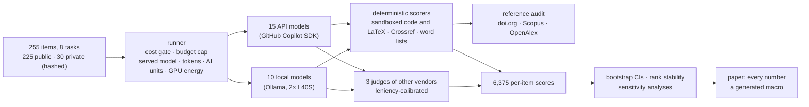

<div align="center">

# SkripsiBench

**Which LLM should Indonesian students, supervisors and thesis tools use — and at what cost? 255 items in eight
thesis tasks, 25 local and API models, the cost and the served model of every call.**

[](https://github.com/devnolife/paper-agent/actions/workflows/ci.yml?query=branch%3Abench)
[](pyproject.toml)
[](LICENSE)
[](paper_bench/build/main.pdf)
[](paper_bench/build/main_id.pdf)

[At a glance](#at-a-glance) · [For reviewers](#for-reviewers) · [Tasks](#the-benchmark) · [Leaderboard](#leaderboard) ·
[Findings](#findings) · [Run it](#run-it) · [Paper](#paper) · [Citation](#citation)

</div>

> [!NOTE]
> This is the **`bench`** branch: the SkripsiBench benchmark and its paper. The paper-agent tool it runs on and the
> paper on silent model substitution are on the [`translate`](https://github.com/devnolife/paper-agent/tree/translate) branch; [`main`](https://github.com/devnolife/paper-agent/tree/main) holds both.

## At a glance

| | |
|---|---|
| **Question** | Vendor leaderboards rank models on English knowledge and reasoning; none says which model to use for a *skripsi*, the Indonesian undergraduate thesis, or for the analysis code behind it |
| **Benchmark** | 255 items in 8 tasks from the thesis workflow — programme-specific chapter outlines, methodology questions, methods extraction from real theses, grounded literature reviews, reference lists, formal Indonesian, data-analysis code, LaTeX |
| **Models** | 15 API models of the GitHub Copilot SDK and 10 local open-weight models (Ollama, two L40S) — 7,356 API calls, US$46.65, 6.1 GPU-hours |
| **Findings** | the three leaders are not significantly different, yet cost differs 104× between models 0.04 apart; references separate the models (0–31 % of an API model's references are found in no database, 61–85 % for local models); the best local model stays below the weakest API model |
| **Paper** | [English](paper_bench/build/main.pdf) (8 pages) · [Indonesian](paper_bench/build/main_id.pdf) |
| **Check it** | `python experiments/bench/verify_release.py` — 9 checks, about 2 seconds, no API key, GPU or private data |

<p align="center">
  
  &nbsp;
  
</p>

---

## For reviewers

> [!TIP]
> The paper's headline numbers can be checked from this branch alone — no API key, no GPU, no private data. CI runs
> step 1 and the test suite on every push (Python 3.10 and 3.12).

### 1 · Verify the released results (about 2 seconds)

```bash
git clone -b bench https://github.com/devnolife/paper-agent.git && cd paper-agent
pip install -e .
python experiments/bench/verify_release.py
```

It recomputes, from the 6,375 released per-item scores, the task and overall scores, the ranking, the
task-stratified rank bootstrap with the paired difference to the leader, the three sensitivity analyses, the served
models of the main run, the SHA-256 of the public items, and the 24 key numbers printed in the paper:

```text
ok    task and overall scores (25 models x 8 tasks, 6375 item scores)                 max |diff| 0.000067 vs summary.json
ok    overall ranking                                                                 same order as summary.json
ok    rank bootstrap: P(rank 1), rank CIs, paired difference to the leader [95 % CI]  max |diff| P(top1) 0.0000, difference/CI 0.00000; rank CIs identical
ok    ranking with prose scored by automatic checks only / judges only                Spearman rho 0.994 / 0.996
ok    ranking without the private extraction task                                     Spearman rho 0.999, largest rank shift 1
ok    ranking with the works found by the reference audit credited                    40 references, Spearman rho 0.999, largest rank shift 1
ok    served model = requested model (main run, API models)                           3825 calls of 15 models
ok    public items match bench/MANIFEST.json (SHA-256)                                225 public items identical, 30 private items listed as hashes only
ok    numbers printed in the paper (generated/numbers.tex)                            24 macros recomputed

9/9 checks agree
```

### 2 · Rebuild the paper from the data (about a minute; needs TeX Live)

```bash
pip install matplotlib
python experiments/bench/make_figures.py     # figures from summary.json, analysis.json, refs_audit.json
python paper_bench/make_tables.py            # tables and every number in the text -> paper_bench/generated/
paper-agent compile paper_bench/main.tex     # 8 pages, 0 undefined references or citations
paper-agent check-citations --tex paper_bench/main.tex --bib paper_bench/references.bib \
                            --report paper_bench/references_report.md
```

No number in the text is typed by hand: each is a macro in
[`generated/numbers.tex`](paper_bench/generated/numbers.tex), written by
[`make_tables.py`](paper_bench/make_tables.py).

### 3 · Where each claim comes from

| Claim (SkripsiBench) | Value | Evidence |
|---|---|---|
| The three leaders are not significantly different | paired difference to the leader 0.006 [−0.014, 0.027] and 0.010 [−0.010, 0.028] | [`analysis.json`](experiments/bench/analysis.json) → `rank_bootstrap.*.diff_ci` |
| Price differs about 100× among comparable models | US$3.12 vs US$0.030 per 100 items for 0.941 vs 0.901 | [`summary.json`](experiments/bench/summary.json) → `models.*.cost.usd_per_100` |
| References separate the models | 0–31 % of an API model's references are found in no database (local models: 61–85 %) | [`refs_audit.json`](experiments/bench/refs_audit.json) → `models.*.no_match_rate` |
| The ranking does not hinge on the judges, the private task or Crossref coverage | Spearman ρ 0.994 (no judges), 0.999 (no private task), 0.999 (audit credited) | `analysis.json` → `judge_sensitivity`, `public_only`, `verification_sensitivity` |
| The judges agree | Krippendorff's α = 0.86 (interval), on 480 answers rated by all three | `analysis.json` → `judges` |
| No silent substitution in this study | served = requested for every call of the main run (3,825) | `summary.json` → `models.*.cost.served` |
| Every citation in the paper is verified | 23 in ≥ 2 independent sources, 5 manual (software, web, manuscript) | [`references_report.md`](paper_bench/references_report.md) |

### 4 · What is released, and what is not

| Released | Not released, and why |
|---|---|
| 225 public items, word lists, item generators, model roster ([`bench/`](bench/README.md)) | the 30 extraction items: masked excerpts of real theses (privacy); their SHA-256 are in [`MANIFEST.json`](bench/MANIFEST.json) |
| runner, scorers, sandbox, judges, statistics ([`paper_agent/bench/`](paper_agent/bench/)) | raw answers and judge ratings: they include the answers on the private excerpts |
| per-item scores of all 25 models, summary, analyses, reference audit (aggregates only) | API credentials: bring your own Copilot token; local models run on any Ollama server |

### 5 · Re-running the benchmark

`paper-agent bench plan` counts the calls and estimates their cost without calling any model; `run` is resumable and
refuses the premium tier and high reasoning effort without `--approve-high-cost`, and `--budget-usd` stops new calls
when a spending cap is reached. This study cost US$46.65 in API calls (answers 21.52, judges 24.50, cost probes 0.63)
and 6.1 GPU-hours. Environment: GitHub Copilot SDK 1.0.9 (Copilot CLI 1.0.73), Ollama 0.22 on two NVIDIA L40S; API
models as enabled for the author's account on 14 October 2026; fixed bootstrap seeds. Hosted models change without
notice, so a re-run measures the models of its own date. Commands: [Run it](#run-it).

### 6 · Threats to validity

One run per model and item; no human validation yet of item keys, judges and extraction silver labels (blind sheets
for two raters are generated by `paper-agent bench human-sheet`); structure references from the theses of one
university; local energy measured on a shared server; the premium tier not included (see [Limitations](#limitations)).

---

## The benchmark

| Task | What the model does | Items | Scored by |
|---|---|---:|---|
| `structure` | outline chapter III (methods) and IV (results) for a thesis title in a study programme | 35 | prevalence-weighted F1 of sub-section families vs. the programme's typical structure (aggregated from a local thesis dataset) |
| `methodology` | multiple-choice questions on research methods and statistics | 60 | accuracy |
| `extraction` | fill a closed-vocabulary methods record from a masked thesis excerpt (**private items**) | 30 | field agreement with cross-vendor silver labels (no model graded by its own vendor) + verbatim-evidence check |
| `grounded` | literature review from six given abstracts, citing `[P1]…[P6]` | 30 | citation coverage/validity, sentence citation rate, unsupported numbers, length; two LLM judges |
| `references` | list five real references with DOI for a topic | 20 | Crossref lookup by DOI, then title + first author (not-found rate, DOI correctness); misses audited in doi.org, Scopus and OpenAlex |
| `language` | abstract from a research summary; formal rewrite of an informal draft | 30 | length, English leakage, non-standard words, kept/fabricated numbers, key terms, sentence length; two LLM judges |
| `coding` | Python data analysis on a synthetic CSV (regression, t/Mann–Whitney, ANOVA+Tukey, Cronbach, N-gain, …) | 30 | the program runs offline in a sandbox; JSON outputs compared within tolerance; pass@1 and pass after one repair |
| `latex` | fix a broken document, typeset a booktabs table, convert a reference to BibTeX | 20 | pdflatex in the sandbox, PDF text, cell-by-cell comparison, BibTeX fields |

Prompts are in Indonesian. Items were written for the benchmark (14 October 2026) except the extraction excerpts,
which come from a local thesis dataset of one Indonesian university and stay private. Full scoring rules:
[`bench/README.md`](bench/README.md).



**Why the scores can be trusted.** Six of the eight tasks are scored without an LLM, and the two prose tasks are
half deterministic. Model-written programs and LaTeX run in a sandbox (Linux user, mount, network and PID namespaces,
no network, capabilities dropped, cgroup limits). References are looked up in Crossref with paper-agent's matching
rule, and every miss is audited again in doi.org, Scopus and OpenAlex. A judge never rates models of its own vendor,
and each judge's leniency is removed before averaging. Failed calls score 0 instead of disappearing.

---

## Leaderboard

25 models ran on 14–15 October 2026: 15 API models of the GitHub Copilot SDK (grouped by name into an economy and a
standard tier, low reasoning effort where a model accepts one) and 10 local open-weight models on a shared Ollama
server with two L40S GPUs. Cost per 100 items: API models in the vendor's AI units at US$0.01, local models as GPU
time at an on-demand L40S price (US$1.09/h).

| # | Model | Tier | Overall [95 % CI] | Academic | Code | US$ / 100 items | Median s / call |
|---:|---|---|---|---:|---:|---:|---:|
| 1 | **kimi-k3** | economy | **0.941** [0.92, 0.96] | 0.930 | 0.975 | 3.119 | 34.5 |
| 2 | **gpt-5.4** | standard | **0.935** [0.92, 0.95] | 0.913 | 1.000 | 0.864 | 7.9 |
| 3 | **gpt-6.1-sol** | standard | **0.931** [0.92, 0.95] | 0.908 | 1.000 | 0.461 | 8.3 |
| 4 | claude-sonnet-5.5 | standard | 0.913 [0.89, 0.93] | 0.890 | 0.983 | 0.783 | 4.8 |
| 5 | gpt-5.6-terra | standard | 0.913 [0.89, 0.94] | 0.898 | 0.958 | 0.585 | 5.9 |
| 6 | gemini-3.7-flash | economy | 0.911 [0.90, 0.92] | 0.882 | 1.000 | 0.141 | 15.4 |
| 7 | gemini-4-argon | standard | 0.901 [0.88, 0.92] | 0.868 | 1.000 | 0.396 | 5.8 |
| 8 | gpt-6-luna | standard | 0.901 [0.87, 0.93] | 0.901 | 0.900 | 0.030 | 7.0 |
| 9 | claude-haiku-5.5 | economy | 0.895 [0.87, 0.92] | 0.868 | 0.975 | 0.056 | 6.8 |
| 10 | gemini-3.8-flash | economy | 0.893 [0.87, 0.91] | 0.857 | 1.000 | 0.145 | 18.6 |
| 11 | gpt-5.4-mini | economy | 0.883 [0.86, 0.91] | 0.868 | 0.931 | 0.252 | 4.8 |
| 12 | claude-sonnet-5 | standard | 0.876 [0.85, 0.90] | 0.834 | 1.000 | 0.711 | 5.8 |
| 13 | mai-code-1.1-flash | economy | 0.837 [0.81, 0.86] | 0.808 | 0.922 | 0.157 | 7.9 |
| 14 | gpt-5-mini | economy | 0.816 [0.78, 0.85] | 0.790 | 0.892 | 0.136 | 7.7 |
| 15 | claude-haiku-4.5 | economy | 0.777 [0.74, 0.81] | 0.762 | 0.823 | 0.598 | 10.6 |
| 16 | Qwen3.6 36B | local | 0.745 [0.71, 0.77] | 0.719 | 0.825 | 0.655 | 57.7 |
| 17 | gpt-oss 20B | local | 0.723 [0.70, 0.74] | 0.661 | 0.908 | 0.087 | 4.1 |
| 18 | Gemma 3 27B | local | 0.691 [0.66, 0.72] | 0.680 | 0.727 | 0.170 | 9.6 |
| 19 | Gemma 4 8B | local | 0.668 [0.64, 0.70] | 0.671 | 0.660 | 0.183 | 13.6 |
| 20 | Phi-4 reasoning plus 14.7B | local | 0.639 [0.60, 0.67] | 0.586 | 0.801 | 0.693 | 8.7 |
| 21 | Qwen2.5-Coder 32B | local | 0.621 [0.59, 0.65] | 0.604 | 0.674 | 0.259 | 20.2 |
| 22 | Qwen3-Coder 30B-A3B | local | 0.618 [0.58, 0.65] | 0.597 | 0.681 | 0.236 | 3.2 |
| 23 | Qwen2.5 7B Instruct | local | 0.518 [0.48, 0.55] | 0.523 | 0.503 | 0.083 | 4.7 |
| 24 | Gemma2 9B CPT SahabatAI | local | 0.517 [0.48, 0.55] | 0.571 | 0.357 | 0.299 | 5.9 |
| 25 | Llama 3.2 3B | local | 0.368 [0.34, 0.40] | 0.408 | 0.248 | 0.067 | 3.4 |

Per-task scores: [`leaderboard.md`](experiments/bench/leaderboard.md) · per-item scores:
[`per_item.csv`](experiments/bench/per_item.csv) · analyses: [`analysis.json`](experiments/bench/analysis.json) ·
reference audit: [`refs_audit.json`](experiments/bench/refs_audit.json)

<details>
<summary><b>Per-task scores at a glance</b> (heatmap)</summary>
<p align="center"></p>
</details>

---

## Findings

<p align="center">
  
</p>

* **The three leaders are not significantly different.** The paired difference to kimi-k3 is 0.006 [−0.014, 0.027]
  for gpt-5.4 and 0.010 [−0.010, 0.028] for gpt-6.1-sol (task-stratified bootstrap). That is not equivalence, and two
  tasks (methodology questions, formal Indonesian) are near ceiling for every API model.
* **Price is what differs.** Per 100 items kimi-k3 costs US$3.12 (it reasons at length: median 34.5 s per call),
  gpt-6.1-sol US$0.46, and gpt-6-luna reaches 0.901 for US$0.030 — 104 times less for 0.04 less. Tier names are a
  poor guide: the most expensive model per item was grouped with the economy models.
* **References separate the models.** 0–40 % of the references an API model listed are not found in Crossref. The
  second-source audit ([`audit_refs.py`](experiments/bench/audit_refs.py)) finds 17 % of those misses with matching
  metadata elsewhere; 0–31 % of an API model's references are found in no database, against 61–85 % for local
  models. Verify every reference a model produces.
* **Local models trail on every task, on average.** The best, Qwen3.6 36B (0.745), stays below the weakest API model
  (claude-haiku-4.5, 0.777), and at rental prices local models were not cheaper per item; they come closest on formal
  Indonesian. The Indonesian-tuned SahabatAI 9B did not write formal Indonesian better than the general Gemma 4 8B.
* **Provenance and judges.** The SDK reported the requested model as the serving model for all 7,356 calls (no
  substitution; the incident that motivated this check is the subject of the [paper-agent paper](https://github.com/devnolife/paper-agent/tree/translate)). The three judges agree (Krippendorff's α = 0.86), and
  scoring the prose by the deterministic checks alone barely changes the ranking (Spearman ρ = 0.994).

> [!NOTE]
> Not in this version: the nine premium-tier models (estimated at about US$50 for all items; the runner gates them
> behind an explicit approval and a budget cap), a high-effort check of the leaders, repeated runs, and the
> comparison of the judges with two human raters.

---

## Run it

```bash
pip install -e ".[copilot,dev]"                 # Python >= 3.11 for the vendor SDK >= 1.0
export BENCH_PRIVATE_DIR=~/bench-private          # private items, silver/gold labels, raw runs
export BENCH_PYTHON=/path/to/python-with-numpy-pandas-scipy-statsmodels-sklearn   # runs model-written code
# API models: an already running Copilot runtime, or a token for a spawned CLI
export COPILOT_RUNTIME_URL=127.0.0.1:4100 COPILOT_CONNECTION_TOKEN=…   # or COPILOT_GITHUB_TOKEN=…

paper-agent bench check                                    # items load, prompts build, sandbox available
paper-agent bench plan --tiers economy standard            # calls and estimated cost, no model calls
paper-agent bench run  --tiers economy standard local --limit-per-task 3 --stage pilot
paper-agent bench run  --tiers economy standard local      # resumable; re-running only does what is missing
paper-agent bench plan --tiers premium                     # read the estimate first …
paper-agent bench run  --tiers premium --approve-high-cost # … premium tier and high effort are gated
paper-agent bench silver --panel copilot:gpt-6.1-sol@low copilot:claude-sonnet-5@low copilot:gemini-4-argon
paper-agent bench score
paper-agent bench judge                                    # judges of other vendors than the candidate's
paper-agent bench human-sheet && paper-agent bench human-ingest   # two human raters, blind
paper-agent bench report --out experiments/bench
python experiments/bench/audit_refs.py                     # second-source audit of the references not in Crossref
python experiments/bench/analyze.py                        # cost, diagnostics, judges, robustness -> analysis.json
python experiments/bench/make_figures.py && python paper_bench/make_tables.py
```

[`bench/models.yaml`](bench/models.yaml) is the study roster (tier and vendor family per model; local models with their
`think` setting and context cap); any model can be added with `--models engine:model[@effort]`. The background
orchestration used for this study (resumable rounds, cost gate, human-rating import) is described in
[`bench/README.md`](bench/README.md).

### Built on paper-agent

SkripsiBench runs on [paper-agent](https://github.com/devnolife/paper-agent/tree/translate)'s engines, which record the served model of every call (the SDK's
usage event for API models, Ollama's response for local ones). Its reference scorer uses paper-agent's verification
rule, and the Indonesian version of the paper was translated by paper-agent's structure-safe `translate-tex`. The tool
is included here because the benchmark needs it; its documentation and its own paper are on the
[`translate`](https://github.com/devnolife/paper-agent/tree/translate) branch.

---

## Paper

**SkripsiBench: Which Language Model for Indonesian Academic Writing and Research Code? Quality, Cost and Provenance
of Local and API Models.** [`paper_bench/`](paper_bench/) — IEEE conference format, 8 pages, 28 references (23 verified in ≥ 2 bibliographic
sources, 5 software/web/manuscript references marked `MANUAL`).

<p align="center">
  <a href="paper_bench/build/main.pdf"></a>
  &nbsp;&nbsp;
  <a href="paper_bench/build/main_id.pdf"></a>
</p>

Every number in the text is a macro generated from the run data, so a new run updates the paper by regenerating and
recompiling. The Indonesian version was translated by `paper-agent translate-tex` from the same sections (111 units,
none left untranslated, glossary compliance 94 %, cosine 0.94 to the back-translation; served models GPT-5 mini,
Claude Haiku 4.5, Gemma 3 27B) and then post-edited in 89 places that [`postedit_id.py`](paper_bench/postedit_id.py)
lists and re-applies. Translating it exposed two masking bugs, now fixed and tested: a `\caption{…}` spanning lines
lost its last character and gained a stray `}`, and a `\paragraph{Title}` followed by text on the same line kept
its title untranslated. [`review.md`](paper_bench/review.md) is the output of `paper-agent review` on the English
paper (critics: gpt-6.1-sol and claude-sonnet-5.5 at low effort): four overclaims it found were softened before
release, and its main points — no human validation yet, single runs, the premium tier missing, confounded local cost
— are the limitations the paper states.

---

## Citation

```bibtex
@unpublished{arya2026skripsibench,
  author = {Andi Agung Dwi Arya B},
  title  = {SkripsiBench: Which Language Model for Indonesian Academic Writing and Research Code?
            Quality, Cost and Provenance of Local and {API} Models},
  year   = {2026},
  note   = {Universitas Hasanuddin. Code and data: \url{https://github.com/devnolife/paper-agent}}
}
```

The provenance check builds on the paper-agent paper:

```bibtex
@unpublished{arya2026paperagent,
  author = {Andi Agung Dwi Arya B},
  title  = {Which Model Actually Answered? Silent Model Substitution, Deterministic Validators,
            and Multi-Model Routing in an {LLM} Paper Agent},
  year   = {2026},
  note   = {Universitas Hasanuddin. Code and data: \url{https://github.com/devnolife/paper-agent}}
}
```

---

## Repository layout

```
bench/                  items (public), model roster, word lists, item generators, MANIFEST.json (hashes of all items)
paper_agent/bench/      runner (cost gate, budget cap, provenance), scorers per task, sandbox, judges,
                        silver labels, human sheets, statistics, report
paper_agent/            the paper-agent package the benchmark runs on (engines, reference verification, translation)
experiments/bench/      results: leaderboard, per-item scores, summary, analyses, reference audit,
                        verify_release.py, analyze.py, audit_refs.py, make_figures.py
paper_bench/            the paper: EN and ID sections, generated tables and number macros, figures,
                        verified bibliography, post-edits of the ID version, both PDFs, review
tests/                  deterministic tests (no network, no models)
```

---

## Limitations

One run per model and item at low reasoning effort, so run-to-run variation is not measured; the structure
references and the extraction excerpts come from the theses of one university; extraction is scored against silver
labels that differ by vendor; the LLM judges and the item keys have not yet been checked by people; reference
verification depends on the coverage of Crossref, doi.org, Scopus and OpenAlex; the served-model check relies on the
SDK's own report; local energy was measured on a shared server and local cost depends on the concurrency used; the
nine premium-tier models are not included.

## License

MIT — see [LICENSE](LICENSE).
